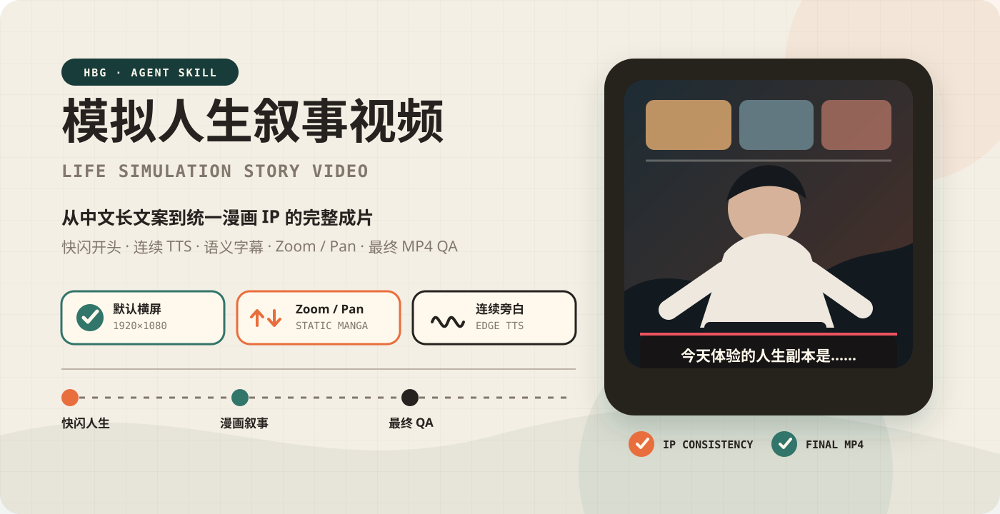

<p align="center">
  
</p>

<p align="center">
  把中文长文本做成<strong>统一角色的 AI 短剧 / 旁白视频</strong>。<br />
  <strong>分镜规划 · 外部 API 批量生图 · 本地 ComfyUI 图转视频 · 口型对白 · 语义字幕 · 成片质检</strong>
</p>

这是在 [hbg-life-simulation](https://github.com/Mr-funny/hbg-life-simulation) 基础上的魔改版。原来的"静态漫画 + 推拉镜头"仍然保留作为兜底,新增了真正的动态镜头,并去掉了账号代理(CLIProxyAPI / OAuth)那一整套。

## 改了什么

| 模块 | 原版 | 现在 |
|---|---|---|
| 生图 | 本地账号代理或内置 ImageGen | **任意 OpenAI 兼容 Images API**(`gen_images.mjs`):并发、每镜多候选、重试、断点续跑、自动归一到画布尺寸 |
| 镜头运动 | 仅 zoom / pan 推拉 | **本地 ComfyUI + MiniMax H3 图转视频**(`animate_shots.mjs`),多实例并行,失败回退推拉 |
| 声音与口型 | Edge TTS 旁白 | 对白镜头由 H3 直接生成人声与口型;旁白用 `edge` 或自定义 `command` 引擎(如本地 TTS) |
| 画幅 | 横屏 1920×1080,竖屏需显式指定 | 任意非方形尺寸 `--size WxH`,排版数值按比例缩放;默认值来自 `.env` |
| HBG 快闪开头 | 必选 | **可选**(`opening.enabled=false`) |
| 密钥 | 代理环境文件 | 只放 `.env` 或进程环境,配置校验会拒绝把密钥写进 `PROJECT_SPEC.json` |

## 快速开始

```bash
cp .env.example .env        # 填写生图 API、ComfyUI 地址;.env 已被 .gitignore 忽略
```

```bash
# 1. 选择画幅(竖屏短剧示例)
node scripts/init_project_style.mjs PROJECT_DIR --size 768x1344 --fps 24

# 2. 批量生图:先 dry-run,再单镜头试跑,最后全量
node scripts/gen_images.mjs PROJECT_DIR --dry-run
node scripts/gen_images.mjs PROJECT_DIR --only s001
node scripts/gen_images.mjs PROJECT_DIR

# 3. 图转视频(每个 COMFY_URLS 实例同时跑一个任务)
node scripts/animate_shots.mjs PROJECT_DIR --dry-run
node scripts/animate_shots.mjs PROJECT_DIR

# 3.5 短剧模式:把分镜表 SHOTS.json 展开成生图任务、故事板和每集的字幕时间轴
node scripts/build_drama_timeline.mjs PROJECT_DIR

# 4. 合成成片(有视频片段用片段,没有则推拉)
node scripts/render_streaming_ffmpeg.mjs PROJECT_DIR renders/ep01-v1.mp4
scripts/verify_final_video.sh renders/ep01-v1.mp4 qa/ep01 1:open 30:mid
```

## 配置

`.env`(参考 `.env.example`):

| 变量 | 说明 |
|---|---|
| `IMAGE_API_BASE_URL` / `IMAGE_API_KEY` | OpenAI 兼容 Images API 的地址与密钥 |
| `IMAGE_MODEL` / `IMAGE_SIZE` | 模型与请求尺寸(9:16 建议 `1152x2048`) |
| `IMAGE_CONCURRENCY` / `IMAGE_CANDIDATES` | 并发数、每镜候选数 |
| `COMFY_URLS` | ComfyUI 地址,逗号分隔,每个实例同时处理一个镜头 |
| `HBG_ORIENTATION` / `HBG_SIZE` | `init_project_style.mjs` 的默认画幅 |

`PROJECT_SPEC.json` 里可配置的部分(详见 [references/project-spec.md](references/project-spec.md)):`imageGeneration`(模型、尺寸、并发、候选数)、`video`(模型、步数、LoRA、帧率、时长范围)、`narration.engine`(`edge` / `command`)与音色、`opening.enabled`。

## 分镜字段

```json
{
  "id": "s014",
  "asset": "assets/generated/scenes/s014.png",
  "duration": 3.2,
  "motionPrompt": "镜头缓慢推近,男人转头看向屏幕",
  "dialogue": { "text": "各位老铁,今天这场直播,我只演示一件事。" },
  "voice": "a calm young adult male voice",
  "ambience": "faint night insects"
}
```

有 `dialogue` 的镜头保留模型生成的人声和口型;没有台词的镜头会要求"只有环境音",否则模型容易自己加背景歌声。详见 [references/motion-and-audio.md](references/motion-and-audio.md)。

## 角色一致性(参考图)

生图任务可带参考图:`{"id":"s001","prompt":"...","references":["assets/anchors/hero.png","assets/anchors/yard.png"]}`。有参考图时走 `/images/edits`(多张用 `image[]`),主角的脸、服装和场景可以跨镜头保持一致。建议先为主角、关键道具和主场景各做一张设定图。

## 声音一致性

H3 的图转视频节点没有音色参考,同一角色在不同镜头里音色会漂移。固定主角或旁白建议用 TTS(`narration.engine: command`)统一生成,镜头本身静音;多人对白镜头再交给 H3 生成。

## 目录

```
SKILL.md                 技能说明与流程
scripts/gen_images.mjs   外部 API 批量生图
scripts/animate_shots.mjs ComfyUI 图转视频
scripts/render_streaming_ffmpeg.mjs  合成(片段 / 推拉 / 字幕 / 混音)
scripts/init_project_style.mjs       画幅与排版初始化
references/              规则与参考(生图、动态与音频、分镜、画幅、渲染 QA)
assets/                  横竖屏样式模板
```

## 安全

- 密钥与服务器地址只放 `.env` 或进程环境,不写入项目文件、提示词、日志或报告。
- ComfyUI 本身没有登录验证,请只在可信局域网暴露端口。
- CI 会拦截提交 `.env` 和疑似密钥。

## 许可

MIT,见 [LICENSE](LICENSE)。
